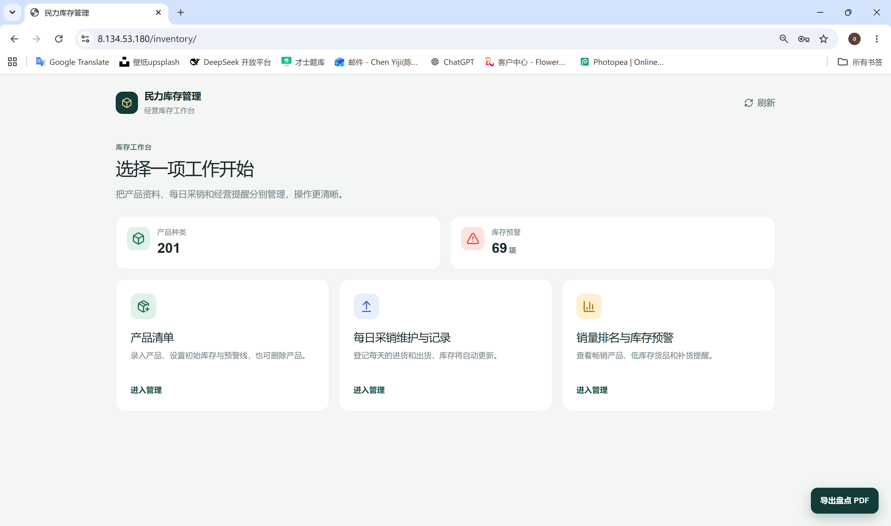
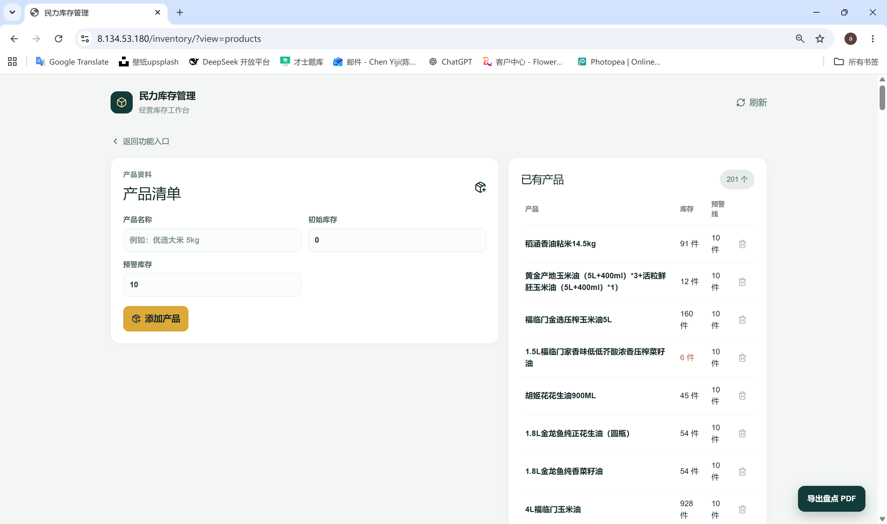
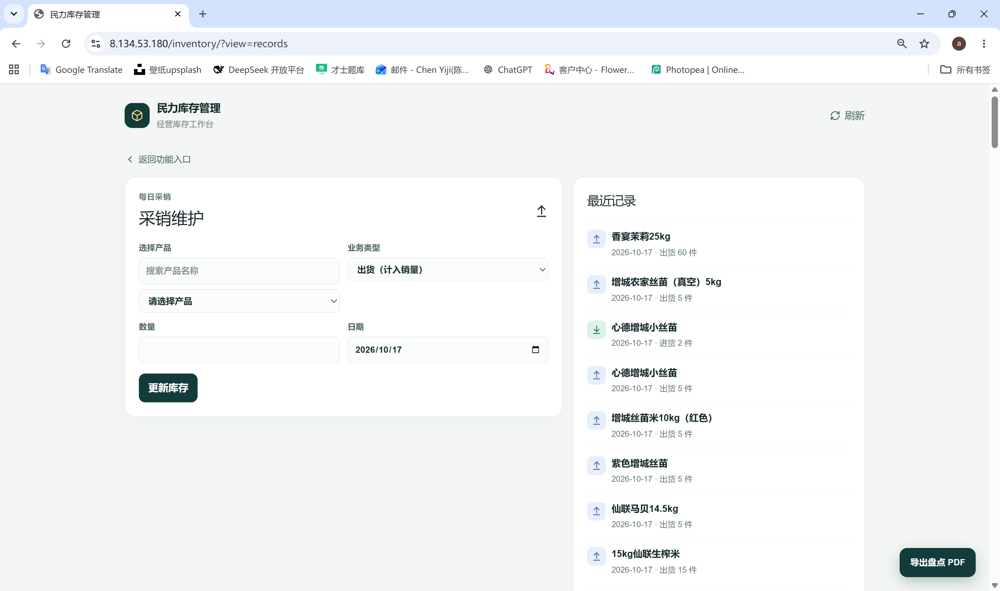
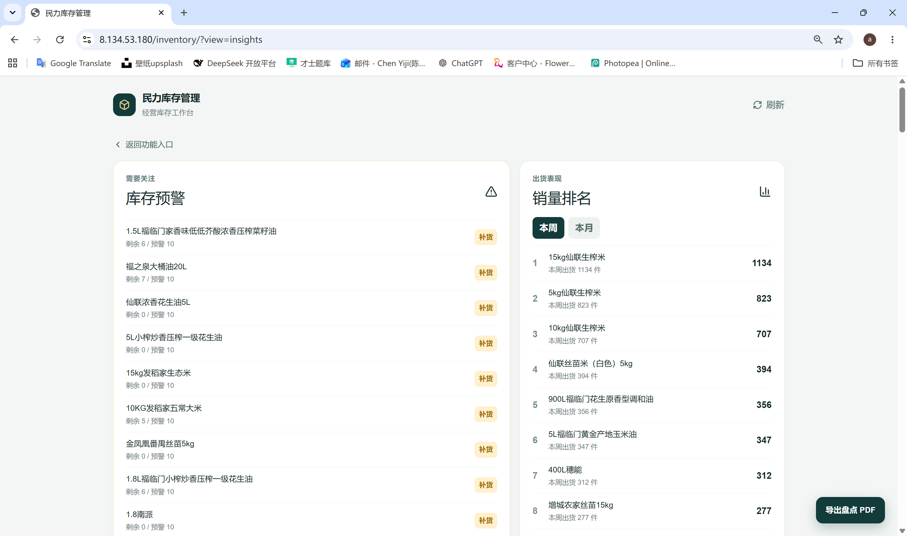

# 民力库存管理

一套面向日常经营的轻量库存管理网站，支持产品建档、进货/出货登记、库存自动更新、库存预警、销量排名和 PDF 盘点清单导出。

线上地址：<https://8.134.53.180/inventory/>

## 功能

- 产品清单：新增产品、设置初始库存和预警库存、删除产品。
- 每日采销维护：按日期登记进货或出货，库存自动增减；出货数量不能超过当前库存。
- 产品搜索：采销登记时可按名称搜索产品。
- 库存预警：实时列出库存低于或等于预警值的产品。
- 销量排名：可按周度或月度查看出货量排行。
- 采销记录：查看最近 100 条完整的进货与出货记录。
- PDF 盘点清单：网站内一键导出适合手机查看和仓库月度盘点的库存 PDF。

## 界面预览

### 功能入口



### 产品清单



### 每日采销维护与记录



### 库存预警与销量排名



## 技术栈

- React / Vinext
- TypeScript
- Drizzle ORM
- Cloudflare D1（开发数据层）
- Nginx + systemd（服务器运行）

## 本地运行

需要 Node.js 22.13 或更高版本。

```bash
npm ci
npm run dev
```

构建生产版本：

```bash
npm run build
```

## 项目结构

```text
app/                        页面与 API
app/api/inventory/          产品、库存与采销记录接口
app/api/stocktake-export/   PDF 盘点清单接口
db/                         数据库连接与表结构
deploy/                     Nginx 与 systemd 部署配置
```

## 部署说明

服务器部署时请使用 `npm ci` 安装依赖，使用 `npm run build` 构建，并由 systemd 管理应用进程。Nginx 负责 HTTPS、访问密码保护和 `/inventory/` 路径转发。

## 安全提示

- 不要提交 `.env`、证书、SSH 私钥或服务器密码。
- `node_modules`、构建缓存和本地数据库状态已由 `.gitignore` 排除；克隆项目后执行 `npm ci` 即可恢复依赖。
